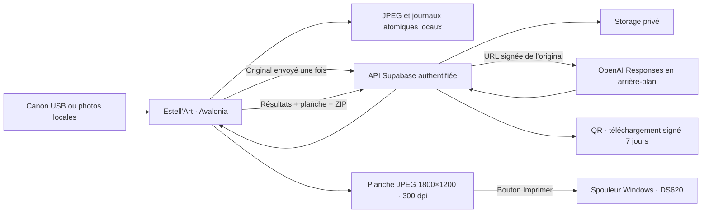

# Architecture livrée pour l’anniversaire

## Parcours des données

## D01 — Avalonia et cœur portable

C#/.NET 10 et Avalonia 12.1.4 permettent de tester les mêmes écrans natifs sur Mac et Windows.
Ce choix remplace la proposition WPF initiale. Les adaptateurs matériels restent Windows x64.
Docker sur Mac ne simule ni le pilote DNP ni le Canon ; les essais réels sont indispensables.

Avalonia documente Windows 10 22H2 comme plateforme Tier 2. La matrice .NET 10 ne liste plus
Windows 10 Pro 22H2 : le premier lancement sur la machine exacte reste une porte explicite.
Le paquet autonome embarquera son runtime ; aucun changement de Windows n’est entrepris.

## D02 — Plein écran et code

F11, Échap et fermeture de la fenêtre demandent le code lorsque le plein écran est verrouillé.
Code de 6–12 chiffres, PBKDF2-SHA256 salé, 600 000 itérations, comparaison constante,
cinq erreurs puis 30 secondes d’attente. Hash, sel et verrouillage sont persistés ; pas le code.
Les réglages sont accessibles seulement après déverrouillage. Le mode n’empêche pas les
raccourcis système Windows : prévoir un compte standard et limiter l’accès au clavier.

## D03 — Canon

`CanonCamera` sérialise EDSDK sur un thread STA et pompe ses événements. La visée JPEG
fonctionne pendant le placement/décompte puis s’arrête avant la commande de capture.
Le callback transfère le vrai JPEG complet, puis la visée reprend entre les poses.
Le délai de capture est de 35 secondes, sans deuxième déclenchement automatique.

Les DLL EDSDK x64 et leurs dépendances sont absentes : Kevin n’a pas de SDK officiel.
L’accès Canon nécessite un compte développeur et doit être obtenu légalement. Les structures
interop doivent être comparées aux en-têtes de la version reçue avant l’essai matériel.
La compatibilité documentaire EOS 4000D n’est pas une preuve d’exécution de cet adaptateur.
Ne pas extraire ou redistribuer les DLL de DSLR Booth. Son API v8 permet de lancer une séance
et ses webhooks signalent les fichiers, mais la documentation ne fournit pas de flux live view
pour remplacer directement notre adaptateur. L’import de photos locales est disponible ;
un pont automatique DSLR Booth reste différé jusqu’à connaissance de sa version/API.

## D04 — Photos et impression

Le pipeline applique les huit orientations EXIF une seule fois, enlève les métadonnées et
normalise les JPEG de travail à 2560 pixels maximum, qualité 96. « Original » signifie ici
photo sans transformation IA, normalisée pour le photomaton, pas un fichier RAW Canon.
La planche est un JPEG 1800×1200 avec densité JFIF 300 dpi : une photo ou quatre cases 2×2,
marges 60 pixels et gouttières 24 pixels. Les sujets sont conservés entiers, sans étirement ;
des marges supplémentaires apparaissent si le ratio diffère.

L’aperçu, l’export et l’impression lisent les mêmes octets vérifiés par SHA-256.
Le pilote est interrogé pour sélectionner 4×6, une copie et une seule page. GDI ajuste au
rectangle imprimable et respecte séparément les résolutions X/Y (dont 300×600).
Le numéro de travail prouve la soumission au spouleur, jamais la sortie papier.
L’intention est journalisée avant soumission ; tout échec ambigu demande une vérification
opérateur et n’entraîne pas de second envoi automatique.

## D05 — API côté serveur

Le projet Supabase dédié héberge Postgres, Storage privé et une Edge Function. La borne a
un secret aléatoire distinct de la clé OpenAI, vérifié par hash côté serveur et protégé
par DPAPI sous Windows. Les tables sont sous RLS, sans droit anon/authenticated.
Usage personnel sur une borne : pas de multi-comptes visiteurs ni de flotte de terminaux.

Les originaux des séances IA sont envoyés avant génération et référencés par URL signée
30 minutes dans OpenAI Responses. Pas de double upload de l’original lors d’une reprise.
Le modèle de contrôle `gpt-6-luna` force un seul outil image `gpt-image-2.5-sunburst`,
`action=edit`, `quality=xhigh`, `1536×1024`, JPEG. Un style est tiré au sort une fois par séance.
Le travail distant utilise `background=true` ; chaque requête Edge reste courte et le PC
interroge l’état toutes les deux secondes, avec deux générations simultanées au maximum.
Ce montage évite d’attendre tout le calcul dans les 150 secondes d’une fonction Free.

Une réservation Postgres transactionnelle bloque les démarrages répétés et limite l’événement
à 2400 images. C’est un plafond de nombre, pas une garantie de coût en dollars. Une réponse
perdue après lancement laisse un travail incertain : aucune génération automatique supplémentaire.
Les originaux peuvent être récupérés explicitement si l’IA échoue. Aucun résultat IA n’est
remplacé silencieusement par un original.

## D06 — Conservation et partage

Fichiers locaux : `%LOCALAPPDATA%\EstellArt`, écritures atomiques et manifestes JSON.
La reprise technique conserve les identifiants/états, mais il n’y a pas encore de navigateur
UI permettant de rouvrir une ancienne séance après redémarrage. Ne pas recréer une séance
IA pour « réessayer » sans contrôler le travail déjà lancé.

Storage conserve originaux, résultats, planche et archive ; le ZIP des séances IA contient
un sous-dossier `originaux/`. Le QR par défaut est un lien signé vers le ZIP, valable 7 jours.
La page mobile préparée utilise un jeton aléatoire dans le fragment de l’URL, dont seul le hash
est enregistré en base. Son hébergement n’est pas actif (GitHub Pages privé refusé).

**Expiration de lien n’est pas suppression des fichiers.** Aucune purge automatique cloud
ou locale n’est activée pour cet anniversaire. Revoir conservation/nettoyage avec Kevin après
l’événement, via l’API Storage avant suppression des métadonnées. Vérifier la capacité avant
600 photos ; le Free à 1 Go n’est pas une réserve suffisante garantie.

## Décisions différées et déclencheurs

| Décision | Déclencheur |
| --- | --- |
| Version EDSDK / ABI et éventuel pont DSLR Booth | Accès au SDK ou au PC avec version DSLR Booth connue |
| Compatibilité Windows 10 exacte | Premier lancement du paquet sur le PC ce soir |
| Couleurs, marges, format DNP | Première mire papier demain |
| Modèle, temps d’attente et budget réels | Premier appel OpenAI manuel autorisé ce soir |
| Offre Supabase / stockage externe | Volume mesuré par séance et nombre attendu de photos |
| Purge cloud / rétention locale | Après récupération des souvenirs de l’anniversaire |
| Galerie web | Hébergement compatible choisi sans upgrade implicite |
