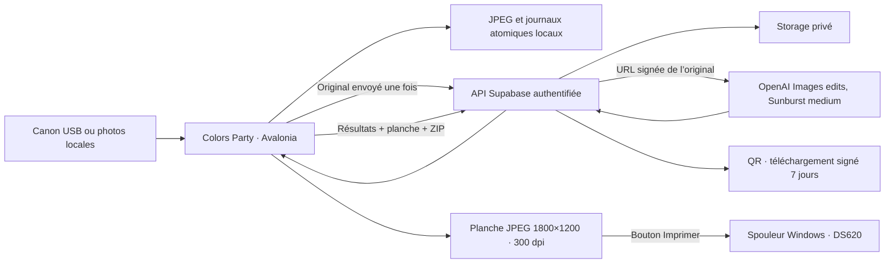

# Architecture livrée pour l’anniversaire

## Parcours des données

## D01 — Avalonia et cœur portable

C#/.NET 10 et Avalonia 12.1.4 permettent de tester les mêmes écrans natifs sur Mac et Windows.
Ce choix remplace la proposition WPF initiale. Les adaptateurs matériels restent Windows x64.
Docker sur Mac ne simule ni le pilote DNP ni le Canon ; les essais réels sont indispensables.

Avalonia documente Windows 10 22H2 comme plateforme Tier 2. La matrice .NET 10 ne liste plus
Windows 10 Pro 22H2 : le premier lancement sur la machine exacte reste une porte explicite.
Le paquet autonome embarquera son runtime ; aucun changement de Windows n’est entrepris.

## D02 — Plein écran et code

F11, Échap et fermeture de la fenêtre demandent le code lorsque le plein écran est verrouillé.
Code facultatif de quatre caractères, PBKDF2-SHA256 salé, 600 000 itérations, comparaison constante,
cinq erreurs puis 30 secondes d’attente. Hash, sel et verrouillage sont persistés ; pas le code.
Les réglages sont accessibles seulement après déverrouillage. Le mode n’empêche pas les
raccourcis système Windows : prévoir un compte standard et limiter l’accès au clavier.

## D03 — Canon sans SDK propriétaire par défaut

`CanonWpdCamera` utilise FC.SDK3.2.1021, bibliothèque C# sous licence MIT qui implémente le
protocole Canon PTP via le pilote WPD/MTP de Windows. Aucun remplacement de pilote, DLL Canon
ou extraction de DSLR Booth. Le transport Windows essaie ioctl puis COM suivant sa sonde.
La version est figée et la licence conservée dans `licenses/FC.SDK-MIT.txt`.

La bibliothèque annonce des essais réels EOS6D et EOS450D, **pas EOS4000D**. La famille PTP
commune permet de préparer cette voie, pas de garantir sa compatibilité. Aucun Canon disponible
ici. Les 25 tests de notre adaptateur injectent un transport fictif : arrêt de visée avant
capture, quatre transferts complets, JPEG après événement RAW, timeout et absence de redéclenchement.
Le bouton de départ du décompte attend une première image de visée dans l’interface.

Le cycle ouvre la séance, active la pompe d’événements, choisit le transfert vers le PC,
affiche les JPEG de visée puis les arrête avant un unique déclenchement. Le JPEG complet est
normalisé et sauvé atomiquement avant accusé de transfert. Après 33 secondes sans JPEG,
erreur explicite, sans deuxième déclenchement. Régler JPEG haute qualité et vérifier la mise
au point : ne pas supposer que la commande de déclenchement fait correctement l’autofocus.

L’adaptateur officiel `CanonCamera`/EDSDK reste disponible en option avancée. Il exige les
DLL x64 licenciées dans `canon/`, la vérification des structures avec ses en-têtes et les
runtimes associés. Kevin ne dispose pas de ce SDK ; l’option WPD évite d’en dépendre pour
la première tentative. Ne pas copier les DLL de DSLR Booth, ni changer ses pilotes.
Son APIv8 et ses webhooks restent une alternative d’intégration à étudier si WPD échoue ;
le retour live view n’est pas documenté comme flux réutilisable. Import local déjà disponible.

## D04 — Photos et impression

Le pipeline applique les huit orientations EXIF une seule fois, enlève les métadonnées et
normalise les JPEG de travail à 2560 pixels maximum, qualité 96. « Original » signifie ici
photo sans transformation IA, normalisée pour le photomaton, pas un fichier RAW Canon.
La planche est un JPEG 1800×1200 avec densité JFIF 300 dpi : une photo ou quatre cases 2×2,
marges 60 pixels et gouttières 24 pixels. Les sujets sont conservés entiers, sans étirement ;
des marges supplémentaires apparaissent si le ratio diffère.

L’aperçu, l’export et l’impression lisent les mêmes octets vérifiés par SHA-256.
Le pilote est interrogé pour sélectionner 4×6, une copie et une seule page. GDI ajuste au
rectangle imprimable et respecte séparément les résolutions X/Y (dont 300×600).
Le numéro de travail prouve la soumission au spouleur, jamais la sortie papier.
L’intention est journalisée avant soumission ; tout échec ambigu demande une vérification
opérateur et n’entraîne pas de second envoi automatique.

## D05 — API côté serveur

Le projet Supabase dédié héberge Postgres, Storage privé et une Edge Function. La borne a
un secret aléatoire distinct de la clé OpenAI, vérifié par hash côté serveur et protégé
par DPAPI sous Windows. Les tables sont sous RLS, sans droit anon/authenticated.
Usage personnel sur une borne : pas de multi-comptes visiteurs ni de flotte de terminaux.

Les copies de génération privées sont préparées en JPEG90, côté long1536px sans crop ni upscale. Les originaux restent distincts et sont archivés pendant le calcul. Chaque pose appelle directement Sunburst via Images edits, medium, 1024×1024, JPEG95. Le prompt carré demande d'étendre le décor autour des personnes pour conserver tous les corps visibles.

Le serveur réserve un travail, démarre l'appel direct dans EdgeRuntime.waitUntil et renvoie202. La borne interroge uniquement l'état serveur toutes les deux secondes. Huit places sont partagées entre séances, avec deux uploads et deux téléchargements à la fois. Le résultat JPEG devient directement un asset de galerie ; la borne vérifie son SHA sans second encodage ni réenvoi. L'archive est construite côté serveur. Une réponse perdue ne déclenche jamais une nouvelle génération.

La planche Métamorphose reste1800×1200 à300dpi : un carré1080 ou quatre carrés528, marges60px et gouttières24px, bande de marque à droite. Le logo et les emblèmes approuvés sont embarqués ; rien ne recouvre les photos. Au naturel et le repli explicite sur les originaux utilisent la composition historique. Les résultats individuels restent séparés de la planche décorée.

Une réservation Postgres transactionnelle bloque les démarrages répétés et limite l’événement
à 2400 images, seize départs par minute et huit travaux non résolus simultanés. Un interrupteur en base arrête les nouvelles générations. C’est un plafond de nombre, pas une garantie de coût en dollars. Une réponse
perdue après lancement laisse un travail incertain : aucune génération automatique supplémentaire.
Les originaux peuvent être récupérés explicitement si l’IA échoue. Aucun résultat IA n’est
remplacé silencieusement par un original.

## D06 — Conservation et partage

Fichiers locaux : `%LOCALAPPDATA%\EstellArt`, écritures atomiques et manifestes JSON.
La reprise technique conserve les identifiants/états, mais il n’y a pas encore de navigateur
UI permettant de rouvrir une ancienne séance après redémarrage. Ne pas recréer une séance
IA pour « réessayer » sans contrôler le travail déjà lancé.

Storage conserve originaux, résultats, planche et archive ; le ZIP des séances IA contient
un sous-dossier `originaux/`. Le QR ouvre la galerie statique Vercel, valable sept jours, avec originaux et métamorphoses associés par pose. Le jeton aléatoire reste dans le fragment de l’URL ; seul son hash est enregistré en base. Le navigateur utilise uniquement le résolveur de lecture, jamais le secret de borne. Chaque fichier peut être téléchargé individuellement, ainsi que le ZIP complet.

**Expiration de lien n’est pas suppression des fichiers.** Aucune purge automatique cloud
ou locale n’est activée pour cet anniversaire. Revoir conservation/nettoyage avec Kevin après
l’événement, via l’API Storage avant suppression des métadonnées. Vérifier la capacité avant
600 photos ; le Free à 1 Go n’est pas une réserve suffisante garantie.

## Décisions différées et déclencheurs

| Décision | Déclencheur |
| --- | --- |
| WPD sur EOS4000D ; EDSDK/ABI ou pont DSLR Booth si nécessaire | Essai USB sur le boîtier demain ; version DSLR Booth si WPD ne suffit pas |
| Compatibilité Windows 10 exacte | Premier lancement du paquet sur le PC ce soir |
| Couleurs, marges, format DNP | Première mire papier demain |
| Modèle, temps d’attente et budget réels | Premier appel OpenAI manuel autorisé ce soir |
| Offre Supabase / stockage externe | Volume mesuré par séance et nombre attendu de photos |
| Purge cloud / rétention locale | Après récupération des souvenirs de l’anniversaire |

## Catalogue et préparation caméra (0.3.0)

Les six univers embarqués sont remplacés en mémoire par GET /styles au lancement ou sur action opérateur. La réponse tardive attend l’accueil si un invité choisit déjà. Les prompts restent serveur ; seule la scène est figée en base par séance. Voir [UNIVERS](UNIVERS.md).

Avant chaque décompte : nouvelle visée, préparation caméra, contrôle de fraîcheur. Un seul déclenchement, transfert JPEG entier, puis reprise de visée. La voie WPD refuse l’autofocus non confirmé ; le secours explicitement configuré exige un objectif en MF et une netteté vérifiée par l’opérateur. Aucun délai arbitraire ne vaut confirmation de focus.

## Monitoring 0.7

Borne → file locale durable → POST monitoring/booth → RPC privé → table booth_metrics. Fournisseur → mesure de réponse indépendante du stockage → même table, sans bloquer les images si la collecte échoue. Galerie → événements de consultation/clic validés par capacité → table privée. Aucun endpoint public de lecture des statistiques. Admin Mac → serveur 127.0.0.1 authentifié → CLI Supabase connectée → fonction SQL de rapport en lecture seule. Tailscale Serve sera configuré sur le Mac ; le dashboard graphique reste à réaliser.

## Projection de salle 0.8

`BoothProjection` conserve les intentions de projection par séance dans une file locale, distincte des traitements photo et du monitoring. Un envoi acquitté supprime uniquement son intention ; les échecs conservent le même identifiant. Le code viewer distinct est protégé par DPAPI et le serveur ne garde que son hash. Le contrôleur Avalonia ne change pas de parcours caméra/impression : l’option ajoute le compteur de retour et l’intention au départ. Le feed SQL sélectionne uniquement les séances libérées et complètement publiées, puis le lecteur web gère l’annonce, la file et le cache borné. [Procédure](VIEWER.md).
