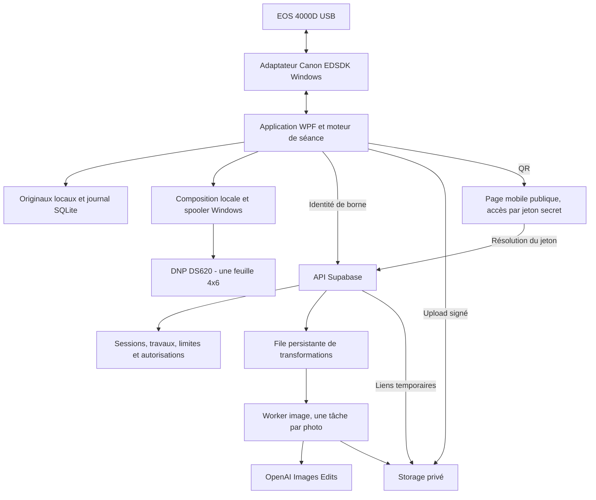

# Architecture et décisions

## Vue d’ensemble

## D01 — Application Windows native, cœur indépendant

**Proposition : C# et WPF**, plutôt qu’un navigateur seul. La borne doit dialoguer avec
un SDK USB natif, gérer le cycle live view/déclenchement, une imprimante et un mode administrateur.
WPF offre une intégration Windows directe et évite un second runtime pour le matériel.
Le cœur C# présent dans le dépôt est portable ; l’hôte WPF n’est pas encore écrit.

Le cœur est actuellement compilé avec .NET 10 sur Mac. Ce choix de développement ne vaut
pas validation du runtime Windows. La [matrice .NET 10](https://github.com/dotnet/core/blob/main/release-notes/10.0/supported-os.md)
consultée ne liste plus Windows 10 Pro 22H2. Premier jalon Windows : relever l’architecture
du PC et vérifier l’exécution, le SDK et le pilote sur la machine exacte.

**Choix recommandé pour la durée :** Windows 11 compatible + runtime LTS supporté, après
vérification Canon/DNP. Si Windows 10 est conservé, documenter explicitement son état de
maintenance et le runtime retenu ; réévaluer un hôte .NET Framework 4.8 et un cœur compatible
si nécessaire. Ne pas démarrer une dépendance à .NET 8 simplement pour gagner quelques jours
avant sa fin de support. Aucun changement de système n’a été effectué.

## D02 — Plein écran applicatif et kiosque système sont deux couches

L’hôte WPF devra contrôler la fermeture, les commandes de fenêtre, le menu administrateur,
le code et le retour automatique au mode borne. Les contrôles se font sur le thread UI ;
les opérations Canon, réseau et impression ne doivent pas le bloquer.

Windows 10 Pro ne fournit pas Shell Launcher pour remplacer le shell par cette application
desktop. Assigned Access en mode mono-application concerne UWP/Edge, pas automatiquement
un exécutable WPF. Shell Launcher existe sur Enterprise/Education/IoT Enterprise et doit
être accompagné de restrictions complémentaires ; il ne bloque pas tout à lui seul.
Sources : [Shell Launcher](https://learn.microsoft.com/en-us/windows/configuration/shell-launcher/),
[Assigned Access](https://learn.microsoft.com/en-us/windows/configuration/assigned-access/).

Sur Pro : compte Windows standard dédié, accès physique au clavier limité, démarrage
automatique configuré et examen des raccourcis/gestes accessibles. Cela réduit les sorties
accidentelles ; ne pas présenter ce mode comme une isolation système absolue. Pour une borne
sans surveillance exigeant cette garantie, décider de l’édition et des politiques avant déploiement.

Le `KioskExitGate` livré est un composant de vérification en mémoire : PBKDF2-SHA256,
sel aléatoire, comparaison à temps constant, cinq erreurs puis trente secondes d’attente.
Il reste à ajouter la persistance du code et du compteur sous DPAPI/ACL, la récupération
administrateur et les contrôles Windows. Un redémarrage du composant efface le verrouillage actuel.

## D03 — Canon EDSDK via USB

Canon liste EOS Rebel T100 / EOS 4000D / EOS 3000D parmi les modèles EDSDK compatibles.
Il s’agit d’une preuve documentaire, pas d’un essai du boîtier de Kevin.
L’EDSDK gère la visée, les réglages, le déclenchement et le transfert ; il exige l’accès
au programme développeur Canon et le respect de sa licence. [Source Canon](https://www.kr.canon/support/sdk/sdkMain).

À implémenter dans l’adaptateur : appels SDK sérialisés, gestion des callbacks et ressources
natives, JPEG de visée remplacé en mémoire sans file infinie, transfert du vrai JPEG avec
écriture atomique, gestion `busy`, autofocus, flash, mise en veille, extinction et reconnexion USB.
La cadence de visée sera mesurée sur le 4000D ; ne pas promettre 30 images/seconde.
Miroir possible à l’écran uniquement ; orientation EXIF corrigée sur les fichiers finaux.

Fermer DSLR Booth et EOS Utility avant le test de possession USB. Le code ne doit pas
récupérer les DLL dans l’installation de DSLR Booth. Ne pas utiliser `getUserMedia` comme
substitut implicite au déclenchement d’un reflex.

Alternative de transition : DSLR Booth/LumaBooth documente des événements de transfert
et une API de démarrage de séance. Cela peut accélérer un pilote temporaire si sa version
installée le permet, mais ne garantit pas une live view intégrable ni l’indépendance du logiciel.
La cible demeure la commande directe. [API et triggers](https://support.lumasoft.co/en/articles/12831651-triggers-webhooks-and-api).

## D04 — Une planche déterministe, une impression locale

Le gabarit de travail est 1800 × 1200 pixels à 300 dpi en paysage, soit nominalement 6 × 4 pouces.
Une photo occupe la planche ; quatre forment une grille 2 × 2. Les marges provisoires de 60 px
et la gouttière de 24 px sont des valeurs de préparation, pas un profil DS620 calibré.

Le pilote DNP gère des dimensions de surface imprimable et un éventuel débordement différents
du simple calcul « pouces × dpi ». Relever `PrintCapabilities` et les options du pilote,
puis étalonner une mire réelle : orientation, recadrage, bords, ICC et mode couleur.
Sélectionner explicitement la DS620, le 4×6, une page et une copie. Ne pas se fier à l’imprimante
par défaut du PC. La coupe en deux bandes 2×6 n’est pas demandée et reste désactivée.
[Pilotes DNP officiels](https://dnpphoto.eu/downloads/).

L’impression se fait depuis la borne, jamais depuis Supabase. L’état « soumis au spooler »
ne prouve pas « papier sorti ». Écrire un identifiant stable de demande dans SQLite **avant**
la soumission, enregistrer l’identifiant spooler et rapprocher après un crash.
Un état inconnu nécessite l’opérateur ; pas de retry aveugle. Le cœur fourni ne couvre encore
que la garde en mémoire, pas cette garantie durable.

## D05 — Supabase orchestre, la clé OpenAI reste côté serveur

Supabase porte les identités de borne, la base, Storage privé, la file de tâches et les API.
L’application ne reçoit jamais `service_role`, la clé secrète Supabase ou la clé OpenAI.
Une clé publishable n’autorise pas à créer des générations : il faut une identité de borne
validée, active, limitée à son événement et à ses quotas.

Chaque séance a des UUID, son mode, son nombre de prises, sa version de prompt, son style
immuable et sa clé d’idempotence. Chaque photo possède un travail indépendant. Les originaux
restent sur disque avant upload ; un journal SQLite permettra de reprendre après interruption.
Les tables et buckets n’acceptent aucun accès visiteur en lecture globale ou en écriture.
RLS et contrôle de propriété doivent être testés avec deux bornes distinctes.

**Ne pas attendre quatre éditions dans une seule requête HTTP.** L’API répond `202`, la borne
interroge le statut et reste réactive. Les limites Edge publiées sont 150 s par worker Free,
400 s sur offre payante, 150 s sans réponse HTTP, 256 Mo et 2 s de CPU par requête.
`waitUntil` ne transforme pas cela en file durable. [Limites Supabase](https://supabase.com/docs/guides/functions/limits).

Point de départ à essayer : une tâche par photo dans une file Postgres durable, worker Edge
borné à une édition, concurrence limitée. Il faut que téléchargement, appel image et sauvegarde
rentrent dans la durée du worker ; une simple moyenne ne suffit pas. En cas de dépassements
mesurés, remplacer **le worker** par un processus conteneurisé persistant sur un hôte à choisir ;
la base et Storage restent Supabase. Ce worker supplémentaire peut avoir un coût : non provisionné.

Les tâches restent persistantes jusqu’à acquittement après sauvegarde vérifiée. Un bail avec
expiration et heartbeat évite les traitements simultanés ; il ne fournit pas une garantie
« exactement une facturation » pour un appel externe. Si OpenAI a traité la requête mais que
la réponse est perdue, noter un résultat incertain et appliquer une politique bornée/opérateur,
pas une boucle de relance payante. [Supabase Queues](https://supabase.com/docs/guides/queues).

## D06 — Images OpenAI et composition

Utiliser `POST /v1/images/edits`, une photo source par travail, `n=1` et un modèle configuré
côté serveur. Pour quatre poses distinctes, `n=4` sur une photo n’est pas équivalent à traiter
les quatre prises. Préserver les sorties individuelles puis composer la planche localement.

Candidat de test au 30 octobre 2026 : `gpt-image-2.5-sunburst`, qualité **`xhigh`**
(Extra High, choix explicite de Kevin), JPEG. Comparer à `gpt-image-2.5-flare` à qualité
identique si l’attente est trop longue ; ne pas réduire la qualité sans décision. Épingler un snapshot
après évaluation. Mesurer temps médian/p95, consommation et fidélité sur des photos autorisées,
dont plusieurs personnes, lunettes, faible lumière et enfants si ce public est prévu.
Le catalogue réel accessible au compte et ses limites doivent être vérifiés avant activation.
[Documentation OpenAI](https://developers.openai.com/api/docs/guides/image-generation).

Ne pas annoncer un temps garanti : certaines requêtes complexes peuvent prendre jusqu’à
deux minutes. Redimensionner les copies d’entrée, corriger l’orientation et retirer les métadonnées
inutiles avant transfert. Conserver le fichier original local intact.

## D07 — QR et galerie

Le QR contient une URL HTTPS accessible aux téléphones des visiteurs, pas `localhost`,
une route Tailscale privée ou une URL de fichier local. Une page statique mobile est à déployer
sur un hébergeur web à déterminer. Les Edge Functions Supabase sans domaine personnalisé
ne sont pas un hébergement HTML générique : leur réponse HTML est réécrite en texte.
Voir [les limites officielles](https://supabase.com/docs/guides/functions/limits).

Accès par jeton aléatoire d’au moins 256 bits, stocké sous forme de hash en base, durée limitée
et révocable. Le fragment `#token` de la page évite de le placer dans les journaux d’URL du serveur
statique. La page transmet le jeton à l’API, qui renvoie des URL Storage signées de courte durée.
Pas de suivi tiers sur la galerie ; ne jamais journaliser le jeton ou les images.
Toute personne possédant le QR peut accéder à la séance : le présenter honnêtement.

Prévoir les téléchargements individuels et la planche. ZIP optionnel après le MVP.
Un lien n’est montré que lorsque la publication est vérifiée. En mode hors ligne, afficher
« Téléchargement indisponible » sans faux QR.

## D08 — Mac, Docker et preuves

Le moteur, les contrats, le backend et des tests synthétiques peuvent être préparés sur Mac.
Docker sur Mac convient à une base/Postgres ou un worker Linux ; il ne remplace pas un Windows
avec les pilotes Canon et DNP. Une VM Windows ajoute des incertitudes USB/ARM et ne valide
toujours pas la borne physique. La validation finale se fera sur le PC de Kevin.

## Décisions délibérément différées

| Décision | Hypothèse actuelle | Déclencheur de revue |
| --- | --- | --- |
| Runtime et OS de l’hôte | C# natif ; cœur .NET 10 | Premier diagnostic sur Windows 10 Pro et choix de maintenance OS |
| Verrouillage système absolu | Pas garanti par le plein écran Pro | Exigence de borne sans surveillance/accès clavier |
| Style par séance | Un style pour quatre photos | Revue des premiers résultats avec Kevin |
| Rétention | Proposition : cloud 7 jours, local 30 jours | Volume réel, usage événementiel et choix de Kevin |
| Worker Edge ou externe | Essai Edge une photo par tâche | Latence p95 et marge sous 150 s insuffisantes |
| Profil DS620 | Master 1800×1200, grille 2×2 | Première mire papier et contrôle du pilote |
| Hébergement galerie | Page statique HTTPS séparée | Domaine/hébergeur disponible avant premier QR réel |
| Fallback DSLR Booth | Secours possible uniquement | Échec/bloquage d’accès à EDSDK et version API installée vérifiée |
