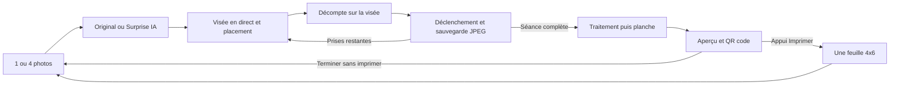

# Cahier des charges — PhotoBooth

Version de préparation du 30 octobre 2026, intégrant les précisions matérielles,
le plein écran protégé et la live view. Ce document est le point de départ de l’implémentation Windows.

## Objectif

Remplacer le parcours actuellement réalisé avec DSLR Booth par une application dédiée,
utilisable sans clavier par les visiteurs d’un photomaton. L’application commande le Canon,
présente les résultats, permet de les récupérer sur téléphone et imprime sur demande.

## Matériel confirmé

| Élément | Choix |
| --- | --- |
| Ordinateur | Windows 10 Pro 22H2 ; processeur, RAM, architecture et écran à relever |
| Appareil photo | Canon EOS 4000D |
| Imprimante | DNP DS620 |
| Consommable | PR 4×6, feuille 4 × 6 pouces, environ 10 × 15 cm |
| Logiciel actuel | DSLR Booth ; version et licence exactes encore inconnues |
| Backend | Nouvelle organisation Supabase PhotoBooth dédiée ; démarrage gratuit |
| Transformations | API OpenAI côté serveur ; compte et facturation API à configurer |
| Qualité IA | **Extra High (`xhigh`)**, explicitement demandé ; consommation API autorisée |

## Parcours visiteur

1. Choisir **1 photo** ou **4 photos**.
2. Choisir **Original** ou **Surprise IA**. Aucun catalogue de styles à choisir.
3. Montrer les personnes **en direct depuis le Canon** afin qu’elles se placent.
4. Afficher un bouton « C’est parti ». Après appui, afficher **5, 4, 3, 2, 1**
   en surimpression de la visée. Durée administrable de 3 à 10 secondes ; défaut proposé : 5.
5. Déclencher une vraie photo et télécharger son JPEG pleine résolution. La coupure
   de visée pendant le déclenchement est normale ; l’interface ne doit pas la confondre
   avec une déconnexion. La miniature de visée n’est jamais le fichier final.
6. Pour quatre prises : bref aperçu de la photo prise, retour à la visée pour changer
   de pose, puis nouveau compte à rebours. Indiquer « Photo 2 sur 4 », etc.
   Attendre la fin du transfert et la disponibilité du boîtier avant la prise suivante.
7. En mode Original, conserver les photos sans transformation esthétique. En mode IA,
   appliquer un style tiré au sort à chacune des photos et afficher une progression réelle
   par photo. Le traitement ne doit pas bloquer le processus de capture ni l’interface.
8. Présenter les résultats et la planche. **Aucune impression automatique.** Le dernier
   choix exprimé par Kevin remplace l’idée initiale d’impression immédiate.
9. Proposer **« Imprimer »** et le **QR code de téléchargement**, indépendants l’un de l’autre.
   On peut télécharger sans imprimer. Le QR mène à une page mobile sans création de compte.
10. Terminer et revenir à l’accueil, en effaçant toute photo de la séance précédente de l’écran.

## Règles de résultat

- Une prise donne **un fichier individuel** et une planche d’une photo.
- Quatre prises donnent **quatre fichiers individuels distincts** et **une seule planche**
  contenant les quatre, dans l’ordre des prises. Proposition de mise en page : grille 2 × 2.
- La planche n’est pas une image inventée par le modèle : l’application compose des
  résultats séparés, pour garantir le nombre, l’ordre et les téléchargements individuels.
- Un seul style surprise par séance de quatre photos, pour une série cohérente.
  C’est une hypothèse produit réversible ; revoir après les premiers essais visuels.
- Tirage du style côté serveur dans une liste contrôlée. Ni nom de célébrité ni artiste
  imposé ; commencer par des ambiances génériques adaptées aux familles.
- Réutiliser le même style en cas de reprise. Une erreur réseau ne déclenche pas un nouveau tirage.
- En mode IA, le lien principal contient les photos modifiées et la planche ; en Original,
  les originales et la planche. Conserver les originaux localement pour récupération.
  Un accès aux originaux dans une séance IA pourra être ajouté plus tard, sans l’exposer implicitement.
- Ne pas annoncer « terminé » si seules trois photos IA sur quatre sont prêtes.
  Proposer une reprise ciblée ou un passage explicite aux originaux, jamais un mélange silencieux.
- Préserver autant que possible visage, nombre de personnes, pose et cadrage dans les prompts.
  Cette fidélité reste à mesurer : une instruction au modèle n’est pas une garantie.

## Plein écran et code administrateur

La borne démarre en plein écran, sans barre de titre ni bouton de fermeture accessible au visiteur.
Un geste administrateur discret ouvre un pavé numérique. Un code valide permet de sortir
du plein écran ou d’ouvrir les réglages ; un mauvais code laisse la borne verrouillée.

- Code choisi à l’installation, sans code universel ni secret dans Git.
- Au moins six chiffres ; dérivation avec sel, stockage Windows protégé, délai après essais infructueux.
- Bloquer les sorties applicatives usuelles, dont Échap, F11 et Alt+F4, tant que le code
  n’a pas été validé. Le simple masquage d’un bouton ne suffit pas.
- Reverrouillage après inactivité de l’administrateur et à chaque redémarrage.
- Prévoir une récupération par le propriétaire Windows ; ne pas enfermer l’administrateur
  dans une machine irrécupérable.
- **Limite explicite :** une fenêtre plein écran et un code ne bloquent pas tous les accès
  système de Windows 10 Pro, ni Ctrl+Alt+Suppr, ni l’accès physique à la machine.
  Un verrouillage système complet est un lot distinct, avec choix d’édition/configuration Windows.

## Fonctionnement dégradé

| Incident | Comportement attendu |
| --- | --- |
| Internet absent avant la séance | Original et impression locale disponibles ; IA indisponible ; aucun faux QR |
| Coupure après les prises | Originaux conservés ; reprise d’upload ; affichage honnête de l’attente |
| Canon absent, occupé ou débranché | Pas de décompte trompeur ; diagnostic et reconnexion sans redémarrer toute la borne |
| Flash ou autofocus lent | Attendre une capture confirmée ; délai borné et intervention opérateur si nécessaire |
| Échec d’une transformation | Conserver les autres résultats ; reprise ciblée avec contrôle du coût |
| API sans crédits ou modération refusée | Pas de boucle automatique ; message récupérable et choix explicite des originaux |
| Imprimante éteinte, ruban/papier épuisé | QR toujours accessible ; impression indisponible avec message clair |
| Doute après soumission au spooler | Ne pas réimprimer automatiquement ; rapprochement par l’opérateur |
| Fermeture/crash de la borne | Retrouver la séance et les travaux depuis le journal local ; pas de double facturation ni tirage automatique |

## Réglages administrateur prévus

Canon sélectionné, exposition/ISO/ouverture, orientation, miroir de visée seulement,
compte à rebours, pause entre prises, imprimante exacte, format et marges, nombre de copies,
style pool, plafond IA, connexion backend, durée de rétention, nouvelle impression supervisée,
code de sortie et écran de diagnostic. Aucun de ces réglages ne doit encombrer le parcours visiteur.

## Hors du premier périmètre

Paiement à la séance, vidéo, GIF, partage par SMS/email, choix de style par le visiteur,
reconnaissance des personnes, plusieurs appareils à la fois, retouche manuelle et galerie publique
globale. La première version cible une seule borne et le matériel confirmé.
