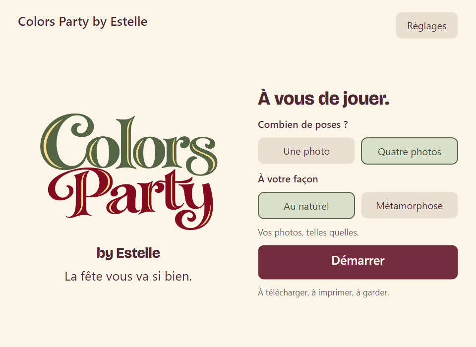

# Colors Party 0.3.0 : preuves

Les captures avant sont celles de main `cf93936256c20a21510e487341469bb5d8aefe0e`, version0.2.2. Les captures après proviennent de la suite Avalonia native headless exécutée sur Mac, avec les mêmes contraintes de fenêtres. Ce sont des fixtures de test, pas des photos d’invités ni des résultats OpenAI.

| État | Avant | Après |
| --- | --- | --- |
| Accueil 1280×800 | [Avant](before/home.png) | [Après](../../../.impeccable/review/desktop-1280x800.png) |
| Choix créatif | [Avant](before/choice.png) | [Six univers](../../../.impeccable/review/surprise-choice.png) |
| Petit écran | | [960×700](../../../.impeccable/review/styles-960x700.png) |
| Attente Halloween | | [Animation capturée](../../../.impeccable/review/processing-halloween.png) |
| Catalogue actualisé | | [Nouvel univers et fond sûr](../../../.impeccable/review/dynamic-styles.png) |
| Réglages | | [Code et plein écran](../../../.impeccable/review/settings-bottom.png) |

Tests Release locaux : 26 métier, 89 image, 50 runtime, 26 impression, 28 séquence Canon, 46 cloud, parcours UI, 11 backend et 5 galerie. Aucun accès matériel ou appel OpenAI dans ces tests. OpenAPI3.0.3 validé. Les huit PNG de produit conservent leur prompt exact et leur provenance intégrée.

[Critique Claude du brief](../../reviews/colors-party/claude-styles.md) et [revue Impeccable](../../reviews/colors-party/impeccable.md). [Supabase déployé et vérifié](backend.json) : migration appliquée, huit contrôles de catalogue/auth/séance, aucune photo envoyée ni génération. Clé OpenAI encore absente. [PR12 fusionnée](https://github.com/djnivek/PhotoBooth/pull/12), [CI Windows finale](https://github.com/djnivek/PhotoBooth/actions/runs/41131796018), [release0.3.0](https://github.com/djnivek/PhotoBooth/releases/tag/v0.3.0). Ne pas confondre cette validation locale avec un test sur le photomaton Windows10.

## Exécutable livré

Source : `d217c000d0cc6efce73c965d95e311f2d9f4209f`. Archive : `ColorsParty-0.3.0-win-x64.zip`, 81 358 679 octets. SHA256 : `05f2fa79062b709f4359d133758508a396e20f9cc814fc384e15f2efc38304e2`.

Le paquet exact a été extrait et exécuté sur Windows Server2022. [Auto-test](windows/self-test.json), [paquet](windows/package.json), [fenêtre initiale](windows/native-ui.json), [fenêtre minimale](windows/native-minimum-ui.json). Les quatre combinaisons une/quatre × original/effet local passent. Aucune vraie capture, aucune feuille ni appel OpenAI. Le rendu de la release est identique octet pour octet aux captures de la PR inspectées avant fusion.

| Vraie fenêtre Windows, 992×700 | Après redimensionnement, 960×700 |
| --- | --- |
|  |  |

Le [reçu de livraison](delivery.json) consigne aussi le contrôle du ZIP retéléchargé depuis la release. Les contrôles applicatifs gardent les raccourcis système Windows hors de leur périmètre. L’accès aux fichiers du PC reste protégé par le code, avec un test complémentaire d’annulation et de sortie autorisée dans la PR de reçus.
