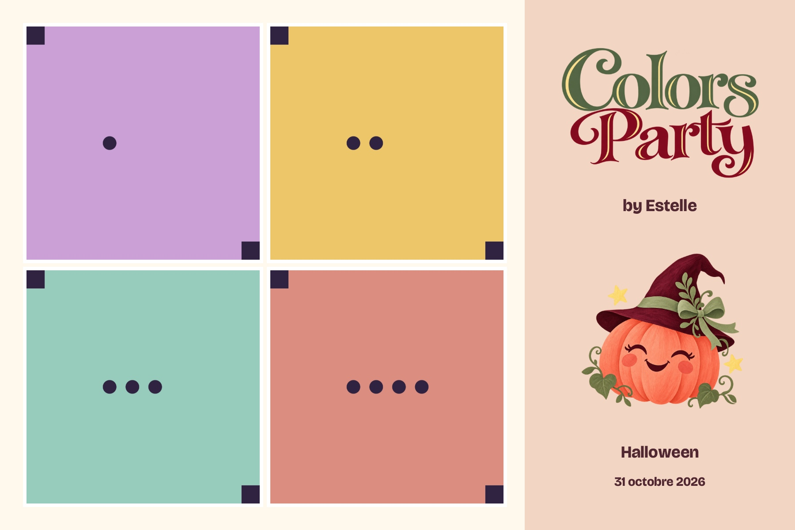
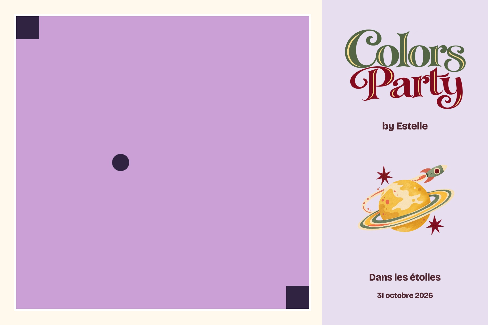
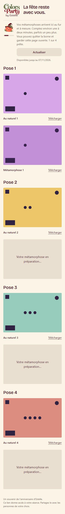
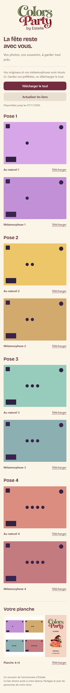

# Planches Métamorphose carrées — 0.6

La photo individuelle demandée à Sunburst est carrée, 1024 × 1024, en qualité medium via Images edits. Le tirage conserve son papier 6 × 4 pouces, son orientation paysage et son fichier 1800 × 1200 à 300 dpi. Les images ci-dessous sont les véritables fichiers de composition produits par le code, avec des mires synthétiques à la place des portraits. Elles ne montrent aucun résultat OpenAI.

Quatre poses : grille de carrés entiers à gauche, logo Colors Party by Estelle et emblème Halloween à droite. Marges photo de 60 pixels et gouttières de 24 pixels, aucune illustration sur les photographies.

Une pose : un grand carré, avec la même structure de marque et l'illustration du thème Dans les étoiles.

Les six univers intégrés et le repli Chef possèdent leur propre illustration approuvée. Une séance Chef utilise le thème effectivement retourné par le serveur. Un thème distant inconnu utilise le décor Chef. Au naturel et le repli explicite sur les originaux gardent la composition historique.

La [revue indépendante](print-review.md) donne **ship pour cette composition des thèmes intégrés**. Les quatorze variantes sont vérifiées à 1800 × 1200 et 300 dpi ; sept ont été inspectées visuellement. Les tests protègent les bords des images, leur ordre et l'absence de modification des originaux. Les couleurs, marges physiques et la sortie papier DNP restent à contrôler avec l'imprimante.

Les tests de parallélisme utilisent un faux fournisseur bloquant : aucun résultat n'est rendu avant le départ des huit appels de deux séances. Les tests n'établissent pas une durée de génération réelle chez OpenAI. Aucun appel payant dans les vérifications automatiques.

## Activation et galerie en production

Kevin a approuvé la planche et l'activation Supabase. L'API 0.6 et la migration sont déployées. Huit est un plafond partagé ; une séance à quatre poses lance quatre appels. Les tests de partage n'appellent pas OpenAI.

48 contrôles vérifient le QR anticipé, une première photo pendant le traitement, les dix assets, les neuf entrées exactes du ZIP et la publication répétable. Chromium reste ouvert sur le vrai site en ordinateur et mobile pendant que le test publie la suite des résultats ; le polling affiche automatiquement quatre métamorphoses, quatre originaux et le ZIP, sans changer l'URL. [Reçu navigateur](progressive-browser.json).

Le [test SQL](verify-concurrency.sql) est entièrement annulé : huit réservations sont acceptées, la neuvième est refusée, cadence, budget et arrêt sont vérifiés. [Reçu](guardrails.json), compteur resté à 1. Audit sécurité sans alerte. [Livraison complète](delivery.json). [PR17](https://github.com/djnivek/PhotoBooth/pull/17), [CI Windows réussie](https://github.com/djnivek/PhotoBooth/actions/runs/41190537146) sur b2a0e12. Aucun changement d'abonnement ou appel OpenAI effectué.

Pour reproduire la vérification avec le code borne déjà provisionné localement : construire `tools/PhotoBooth.CloudSmoke` en Release, installer les dépendances et Chromium de `tests/browser`, puis lancer `node scripts/verify-production-gallery.cjs`. Cette commande écrit une séance synthétique sur la production, lit son jeton uniquement dans les artefacts privés locaux, vérifie la progression dans Chromium et ne déclenche aucune génération. Les captures et reçus restent dans `artifacts/direct-square-0.6.0/live-smoke/`.
