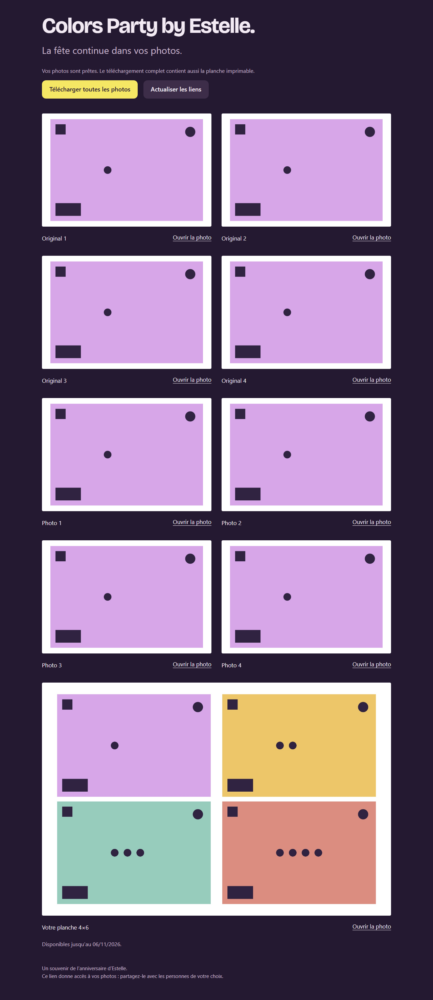
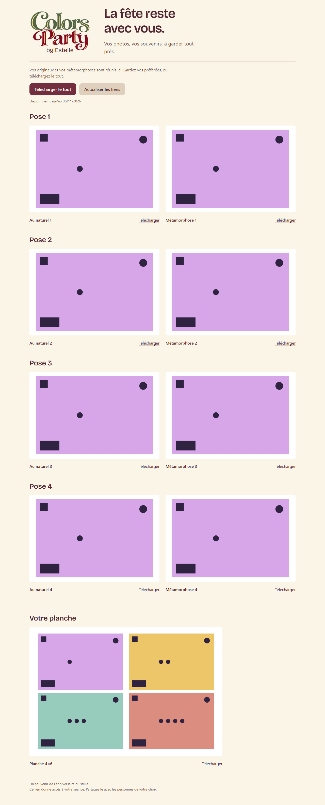
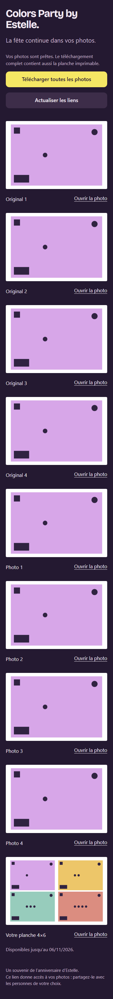
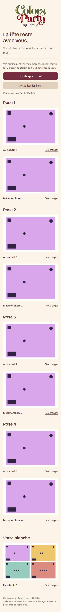

# Offline capture, protected generation and guest gallery

PR head tested in Windows CI: `5cf95a5d52ab4dd2d6985510fc1bdd3646c4e4e5`, [run 41137416834](https://github.com/djnivek/PhotoBooth/actions/runs/41137416834). All local checks, Chromium tests, extracted Windows executable self-tests and native window execution passed. GitHub tested the PR merge revision `30baf8c721ab65081e918ec6d14ed02dc00fd18c`; [package receipt](windows-package-pr.json) records that exact source. This rehearsal ZIP is not the final main-branch release. This evidence is separate from physical Canon/DS620 operation and a real OpenAI render.

| Before | After |
| --- | --- |
|  |  |
|  |  |

Before: source `ee56e3b76bcc0472a3e4c321c5c54f61926c237b`. After: the tested source above. Chromium viewport 1280×900 and 390×844, full-page captures. Calibration charts are intentionally synthetic; no guest photo or paid generation appears here. The repeated single-pose chart verifies rendering, while separate real signed-asset byte comparisons verify original/final preservation.

- [Browser cases](browser.json): one/four poses, original/modified, desktop/mobile; loading, missing/expired link, offline/recovery and successive QR navigation.
- [Local tests](local.json), [Windows CI](windows-ci.json), [independent visual review](../../reviews/offline-gallery/impeccable.md).
- [Offline one photo](../../../.impeccable/review/offline-original-1.png), [offline four photos](../../../.impeccable/review/offline-original-4.png). Cloud configured, HTTP deliberately failing, exact reviewed print bytes preserved, no fabricated QR and no generation request.
- [Live sharing](supabase-share.json): four originals, four local effects, sheet and archive, repeated publication, zero generation calls.
- [Live HTTP verification](live.json): deployed site bytes, all ten signed assets, individual attachment download, CORS, unauthorized API probes including gallery token as bearer.
- [SQL guardrails](guardrails.json): real transactional limits and privilege test, all changes rolled back, zero started before/after, security advisors without warnings/errors.

The first browser run exposed test-case navigation reusing an existing page; cases now navigate independently. The actual guest page also reloads its capability when a phone reuses a tab for another QR. Superseded runs were cancelled; the completed run above is the valid receipt.

The Vercel gallery is public static code only. The repository and Supabase photo bucket stay private. No plan upgrade or paid provider call. Package publication and physical rehearsal status are tracked in [HANDOFF](../../HANDOFF.md).
