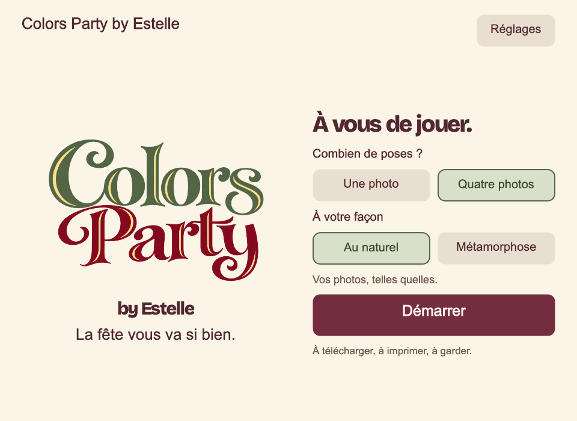
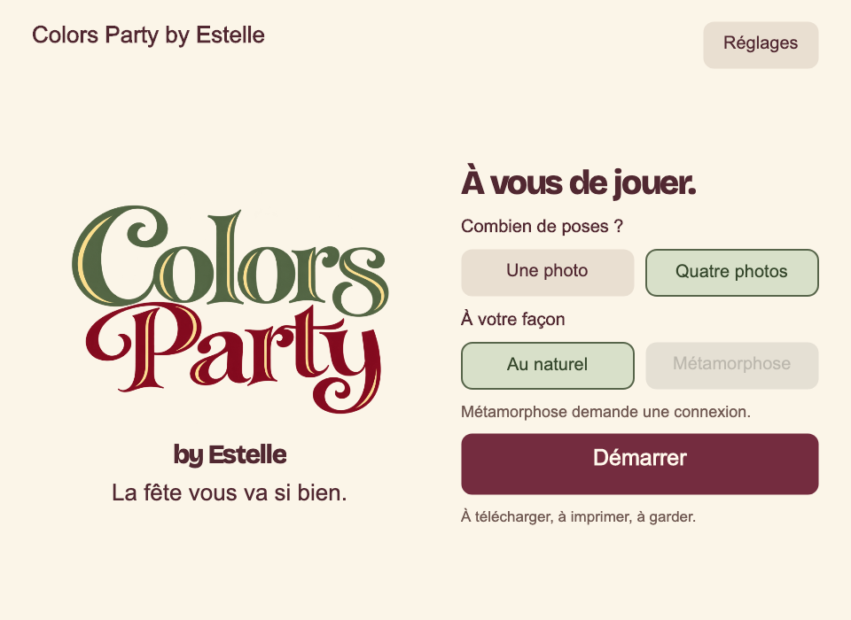

# Canon sans connexion cloud

Même configuration avant et après le garde-fou : Canon sélectionné, connexion cloud désactivée. Captures natives Avalonia headless sur Mac, avec transport caméra injecté ; aucun Canon, aucune photo personnelle, aucun appel OpenAI. Les autres correctifs techniques étaient déjà appliqués lors de la capture avant. Les dimensions correspondent à la zone de contenu.

| Taille | Avant | Après |
| --- | --- | --- |
| 1280×800 | [Avant](before-1280x800.png) | [Après](after-1280x800.png) |
| 960×700 | [Avant](before-960x700.png) | [Après](after-960x700.png) |

Métamorphose utilisait silencieusement l'effet de répétition. Il est maintenant désactivé dans cette configuration, avec une explication dans la ligne existante. Au naturel est sélectionné et conserve la capture, l'aperçu et l'impression locale. La répétition sans Canon garde ses deux modes. Le test vérifie aussi que le parcours Au naturel aboutit à une planche.

Revue Impeccable limitée à cet état : identité, illustration, palette, typographie, tailles tactiles et disposition conservées ; texte lisible sans débord aux deux tailles ; état désactivé conforme au style existant. Détecteur mécanique : aucune alerte sur le fichier modifié. Cette vérification ne constitue pas une validation du matériel Windows.

Le contexte Impeccable signale un sidecar ancien, une plateforme native non reconnue par son parseur et un choix historique de build non renseigné. Pas de remise à jour globale de la documentation de design dans ce correctif ; l'implémentation et le brief de surface existants restent les références visuelles.
