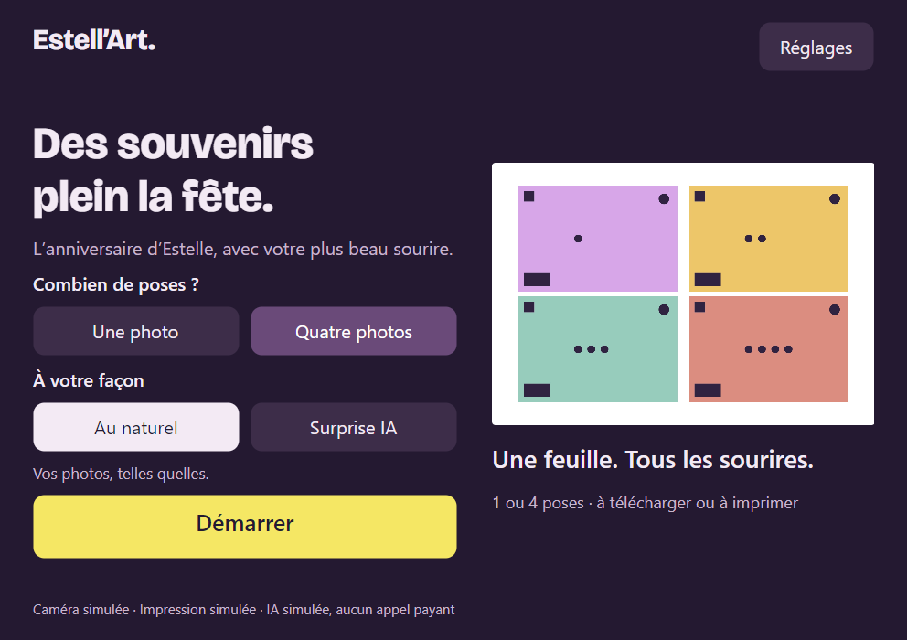
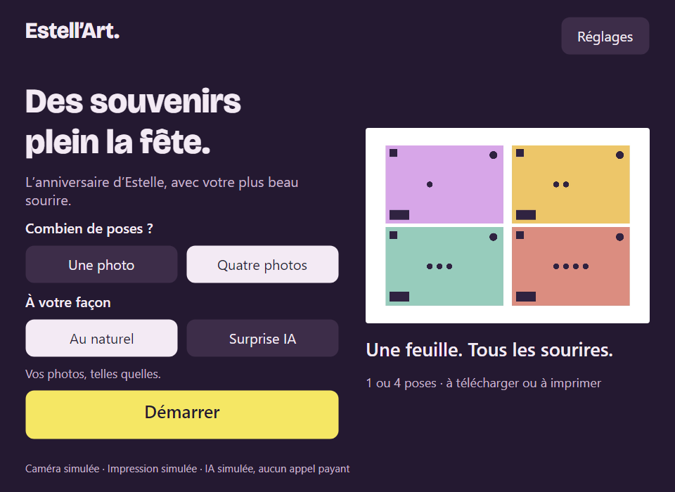

# Windows 0.2.1 delivery evidence

[Private release](https://github.com/djnivek/PhotoBooth/releases/tag/v0.2.1) ·
[Windows CI](https://github.com/djnivek/PhotoBooth/actions/runs/41116597603) ·
[Fixes and screenshots, PR9](https://github.com/djnivek/PhotoBooth/pull/9) ·
[Final review](../../reviews/2026-10-30-final-review.md).

Source commit: `2e026337ab8341bc37608d55dcc3ea67be0db314`.
Archive: `EstellArt-0.2.1-win-x64.zip`, 71,148,214 bytes.
SHA-256: `e51329e3b769600bb6ae222021968048bbdff85e278520d5a8bcbf74df5f9120`.

The Windows runner built the self-contained app, zipped it, extracted it into a fresh directory
and executed that extracted copy. All four one/four-pose and original/simulated-effect flows passed,
including print raster/journal, ZIP contents, QR generation, PIN and DPAPI. The complete CI suite
also exercised two consecutive UI sessions, cancelled slow connections, late driver errors,
PIN-protected file access and print completion after switching sessions.

The actual Windows window opened at992×700 and was resized to960×700. Buttons and sheet stayed
inside their containing panels and client bounds. These desktop/minimum pixels are byte-identical
to the previously inspected PR9 captures. No physical device or paid OpenAI endpoint was used.
The published release ZIP was downloaded again and its integrity, size and SHA-256 matched.

| Receipt | Scope |
| --- | --- |
| [delivery.json](delivery.json) | Published release, exact source, archive inventory and remaining gates |
| [package.json](package.json) | Windows packaging and extracted executable result |
| [self-test.json](self-test.json) | Four rehearsal modes, ZIP2/3/5/9 entries, no paid calls |
| [native-ui.json](native-ui.json) | Native initial geometry and screenshot hash |
| [native-minimum-ui.json](native-minimum-ui.json) | Actual resize and bounds checks |
| [desktop-client.json](desktop-client.json) | Desktop capture bounds |

The colored images are synthetic calibration fixtures. Windows10Pro22H2, EOS4000D live view/capture,
DS620 physical paper, phone QR and the first voluntary OpenAI edit remain untested. The app is unsigned.
The storage plan is unchanged pending tomorrow's successful trials.
